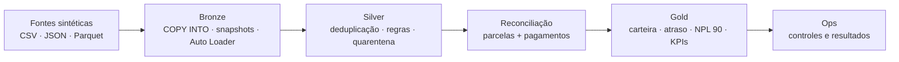

# CredLake — analytics de carteira de crédito no Databricks

Lakehouse demonstrativo para uma carteira de crédito **inteiramente sintética**. O projeto combina formatos e padrões de ingestão diferentes, aplica regras de qualidade e reconciliação financeira e publica uma visão analítica sem PII na camada Gold.

**Estado:** implementação completa no repositório, com job Databricks versionado e testes estáticos. A auditoria local validou sintaxe, arquivos esperados, referências do job e ausência de credenciais óbvias; a execução Spark ainda precisa ser confirmada em um workspace Databricks compatível.

> Nomes, documentos e e-mails são gerados para a demonstração e não representam pessoas reais.

## Problema

Clientes, produtos, contratos, parcelas e pagamentos possuem grãos e regras diferentes. Somar esses dados sem deduplicação, integridade referencial e uma data de referência reproduzível produz saldos e indicadores inconsistentes.

## Solução implementada



| Origem | Padrão | Motivo |
| --- | --- | --- |
| produtos e contratos em CSV | `COPY INTO` | carga incremental por arquivo |
| clientes em JSON | snapshot com `replaceWhere` | substituição limitada à data recebida |
| parcelas em Parquet | snapshot com `replaceWhere` | preservação de schema tipado |
| pagamentos em JSON | Auto Loader com `availableNow` | descoberta incremental, checkpoint e resgate de schema |

O gerador inclui deliberadamente contrato duplicado, principal negativo, referência a cliente inexistente, pagamento duplicado e valor nulo. A Bronze preserva a entrada; a Silver separa registros válidos e quarentenas com códigos e motivos; a Gold remove nome, documento e e-mail.

## Modelo e indicadores

A data do snapshot, não o relógio da execução, governa os cálculos:

```text
total_paid       = pagamentos válidos até a data de referência
outstanding      = max(scheduled_amount - total_paid, 0)
days_past_due    = data de referência - vencimento, quando há saldo vencido
overpaid_amount  = max(total_paid - scheduled_amount, 0)
```

O contrato é agregado nas faixas `CURRENT`, `DPD_01_30`, `DPD_31_60`, `DPD_61_90` e `DPD_90_PLUS`. `NPL 90` significa atraso superior a 90 dias dentro deste modelo sintético.

As contagens descritas no código-fonte — 2.000 clientes e 5.000 contratos válidos — são parâmetros esperados da geração determinística. Devem ser confirmadas em `credlake.ops.data_quality_results` após uma execução limpa.

## Estrutura

```text
src/credlake/       notebooks canônicos 00–10 e reset manual 99
resources/          Lakeflow Job do bundle
sql/                consultas de análise
docs/               arquitetura, dicionário, runbook e guia de entrevista
tests/              contrato estático do repositório
```

Os `.ipynb` da raiz preservam uma versão anterior. O fluxo canônico e orquestrado está em `src/credlake/`.

## Executar

Pré-requisitos: workspace Databricks com Unity Catalog, permissão para criar catálogo/schemas/volumes/tabelas e compute compatível com Auto Loader e Structured Streaming.

```bash
databricks auth login
databricks bundle validate -t dev
databricks bundle deploy -t dev
databricks bundle run credlake_end_to_end -t dev
```

Para execução manual e recuperação segura, siga o [runbook](docs/runbook.md). O utilitário `99_reset_demo.py` é destrutivo e exige confirmação explícita dentro do notebook; ele não faz parte do job.

## Verificações

O workflow `.github/workflows/repository-quality.yml` e o teste local verificam estrutura, sintaxe dos notebooks Databricks, caminhos do job e padrões simples de credenciais.

```bash
python -m pytest tests -q
```

Isso não executa Spark nem comprova tabelas no workspace. O aceite operacional exige rodar o bundle e confirmar que todos os registros mais recentes em `credlake.ops.data_quality_results` têm `passed = true`.

## Limitações

- os dados e o modelo de juros simples são didáticos;
- não há evidência versionada de uma execução recente do job no workspace;
- a Gold representa uma posição por snapshot, sem SCD Tipo 2;
- pagamentos não cobrem estornos e todos os casos do ciclo de crédito;
- a escala atual não justifica particionamento; clustering deve ser decidido a partir de filtros e volume reais.

Detalhes: [arquitetura](docs/architecture.md), [dicionário](docs/data_dictionary.md), [runbook](docs/runbook.md) e [guia de entrevista](docs/interview-guide.md).
